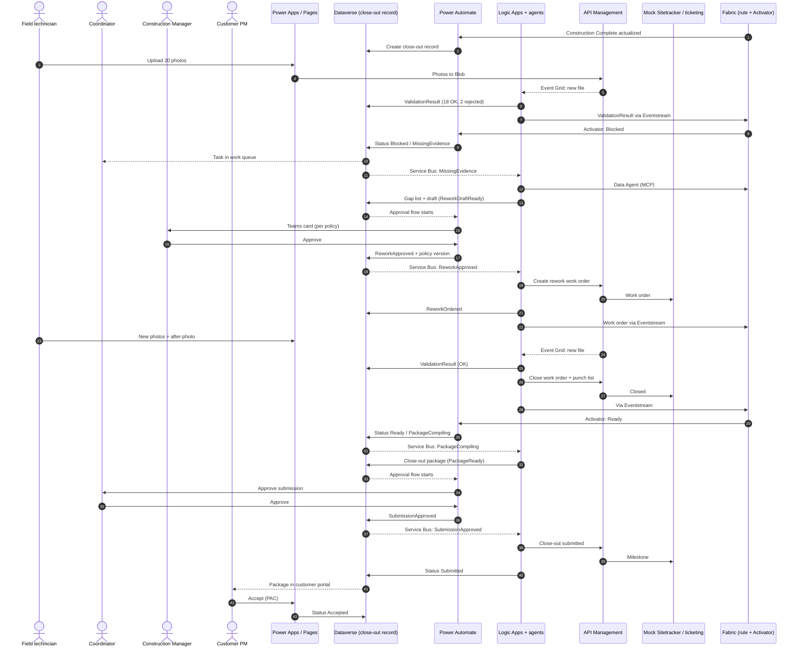

# Close-out readiness – demo definition and ownership

**Ericsson E2E Agentic Deployment Platform – representative-data demonstration (Main Document, section 8)**
Version 2.0 (EN) · 27 October 2026 · Microsoft Confidential

| Track | Owner | Scope |
|---|---|---|
| **Power Platform** | Power Platform track owner | Dataverse (close-out record = process instance), business process flow, Power Apps, Power Pages, Power Automate (status and approval flows), Teams approvals, Copilot Studio, Power Platform pipelines |
| **Fabric** | Fabric track owner | Synthetic structured data, OneLake, Data Factory, notebooks, AI functions, ontology (Fabric IQ) and semantic model, close-out rule, Eventstream, Eventhouse, Activator, Data Agent, Power BI, Fabric Maps |
| **Azure/Foundry** | Azure/Foundry track owner | Synthetic photos and documents in Blob, Logic Apps (short runs per event), Foundry agents, Content Understanding, Foundry IQ, API Management, mock systems of record (Sitetracker and ticketing), Event Grid, Service Bus, Entra, Application Insights, evals, cost |

---

## 1. The process we demonstrate

Close-out is an established process in wireless network rollout: a site can be physically complete yet not accepted until the evidence in the close-out package is consistent. The package triggers Provisional Acceptance (PAC) and payment.

```
Construction Complete (milestone actualized)
   → Evidence collected: photos against checklist and RFDS, as-built, draft acceptance certificate, integration test report
   → Quality check: photos and documents validated, punch list reconciled
   → [Gaps?] → Rework via subcontractor work order → new evidence → re-check
   → Close-out package compiled
   → Close-out Coordinator submits (milestone "Close-out Submitted")
   → Customer PM accepts (PAC) · FAC mentioned as next step
```

**Close-out rule** – close-out may be submitted only when:
1. the site's *Construction Complete* milestone is actualized,
2. all mandatory artefacts for the customer program are validated,
3. no blocking punch list items are open,
4. no rework work orders are open.

**Decision rights:** Construction Manager approves rework. Close-out Coordinator submits. Customer PM accepts (PAC).

---

## 2. Roles in the demo

| Role | Organisation | Surface | Built by |
|---|---|---|---|
| Close-out Coordinator | Ericsson | Power Apps (Site 360, work queue), Teams | Power Platform |
| Construction Manager | Ericsson | Teams (approval card), Power Apps | Power Platform |
| Subcontractor / field technician | Subcontractor | Power Apps mobile (work orders, photos, punch list) | Power Platform |
| Customer PM | Customer (external) | Power Pages with Entra External ID | Power Platform |
| Data steward | Ericsson | Power Apps (duplicate review queue) | Power Platform |
| Citizen developer | Ericsson | Power Apps, Power Automate, pipelines (step 11) | Power Platform |
| Program leadership | Ericsson | Power BI (KPIs), Activator alerts | Fabric |
| Presenter | Microsoft | Presenter console (web app): demo panel, case tracker, decision log, links to traces | Azure/Foundry |

---

## 3. Architecture principles

**The process lives in the app.** The close-out record per site in Dataverse is the process instance. It carries stages (business process flow), status and status reason, and the result of the close-out rule as columns. A status change on the record is the event. Every flow and run starts only when there is work to do, does its job and ends. No run waits for days.

**Separation of concerns**
- **Power Platform** owns the process instance, status transitions, work queues, forms, approvals and the approval policy, reminders and escalation.
- **Logic Apps** performs short, idempotent runs per event: photo validation, agent calls and governed writes to systems of record via API Management. The result is always written back to the record.
- **Fabric** owns the shared view of the site (the ontology), evaluates the close-out rule and signals when a site becomes *Blocked* or *Ready*.

**Other principles**
- **Files in Blob, structure in Fabric, document knowledge in Foundry IQ.** Photos and documents are never stored in Fabric; Fabric holds metadata and validation results with a reference (blob URL).
- **All writes to systems of record go through API Management** as governed business actions with schema, idempotency and roles. Agents propose; people or policy decide.
- **One writer per status transition** (see section 5) and row version (ETag) on the record.
- **The same `caseId`** in every record, run, event, call and log entry.
- **Fast path for the rule:** validation results and executed business actions are sent directly to Eventstream so the rule is evaluated within seconds. Link to Fabric is used for history, decision log and KPIs.
- **Sweden Central, synthetic data, every step labelled** GA, configuration, custom logic or preview. Temporary approved exception: Azure AI Search uses France Central because Sweden Central has no capacity; this does not relocate the other components.

**Relation to the RFI response (if Ericsson asks)**
> R4 describes a process engine that starts or resumes the process instance and records every transition. In the demo, the process instance is the close-out record in Dataverse: state lives in data, each step is a short, idempotent run triggered by a status change, and every transition is recorded in Dataverse auditing and the decision log. This gives recoverability without runs that wait for weeks. For processes with long technical waits, the platform offers Durable Functions with the Durable Task Scheduler and Logic Apps stateful workflows. Approvals in Power Automate and governed writeback via API Management and Logic Apps follow section 8.3.

---

## 4. Data model and ontology

This is the shared contract for Fabric, Dataverse and Azure. The Fabric track builds the ontology from it; the Power Platform track builds the Dataverse tables for the objects mastered in Dataverse; the Azure/Foundry track reads and writes using the same names.

### 4.1 Objects, master and binding

| Object | Master (written by) | Copy / binding | Comment |
|---|---|---|---|
| CustomerProject | Fabric (synthetic Sitetracker extract) | Read by Dataverse via virtual table or sync | Customer program, e.g. CUST-A-5G-ROLLOUT |
| ArtifactRequirement | Fabric (synthetic program configuration) | – | Which artefacts are mandatory per program |
| ChecklistItem | Fabric (synthetic program configuration) | – | Photo checklist items per program |
| Site | Fabric (after entity resolution) | Read by Power Apps | Central entity |
| Milestone | Mock Sitetracker → Eventstream → Fabric | – | Per site and project |
| Subcontractor | Fabric (after name normalisation) | – | |
| WorkOrder | Mock Sitetracker → Eventstream → Fabric | Shown in mobile app | Installation and rework |
| Ticket (punch list) | Mock ticketing system → Eventstream → Fabric | Shown in mobile app | |
| AcceptanceArtifact | Dataverse (created by Azure API on upload) | Eventstream → Fabric | Document level: photo pack, as-built, certificate, RFDS, test report, close-out package |
| Photo | Dataverse (created by Azure API on upload) | Eventstream → Fabric | One photo, linked to a checklist item |
| ValidationResult | Dataverse (written by Logic Apps) | Eventstream → Fabric | One result per photo or document and check |
| CloseOutCase | Dataverse (process instance) | Link to Fabric → OneLake → ontology | Status owned by Dataverse; readiness evaluated in Fabric |
| DecisionLogEntry | Dataverse (append-only) | Link to Fabric | Optional in the ontology |
| EntityMatchCandidate | Fabric writes to Dataverse | Decisions back via Link to Fabric | Duplicate review queue |

### 4.2 Properties (minimum set)

| Object | Key | Properties |
|---|---|---|
| CustomerProject | projectId | programCode, customerName, customerId, market (SE/NO), lowConfidenceThreshold |
| ArtifactRequirement | requirementId | projectId, artifactType (`photo_pack`, `as_built`, `acceptance_certificate`, `rfds`, `integration_test_report`, `customer_pre_acceptance`), mandatory (bool), phase (`close_out`) |
| ChecklistItem | checklistItemId | requirementId, itemCode (`antenna_label`, `cabling`, `grounding`, `safety_signage`, `azimuth_sector_a`, `azimuth_sector_b`, `azimuth_sector_c`, …), description, mandatory (bool), rfdsCheck (bool) |
| Site | siteId | siteName, sourceSiteIds[], projectId, market, latitude, longitude, siteType, currentPhase, readiness (`NotReady`/`Blocked`/`Ready`, computed), readinessMissing[] (computed), readinessEvaluatedAt |
| Milestone | milestoneId | siteId, projectId, milestoneType (`ConstructionComplete`, `IntegrationComplete`, `CloseOutSubmitted`, `PAC`), status (`Planned`/`Actualized`), plannedDate, actualDate, sourceUpdatedAt, isStale (bool) |
| Subcontractor | subcontractorId | name, normalizedName, sourceNames[] |
| WorkOrder | workOrderId | siteId, subcontractorId, workOrderType (`Installation`/`Rework`), status (`Open`/`InProgress`/`Closed`), caseId (for rework), reason, createdAt, dueDate, closedAt, version |
| Ticket | ticketId | siteId, ticketType (`PunchList`/`Other`), blocking (bool), status (`Open`/`Closed`), description, checklistItemCode, openedAt, closedAt, closingPhotoId |
| AcceptanceArtifact | artifactId | siteId, requirementId, artifactType, status (`Missing`/`Submitted`/`Validated`/`Rejected`), blobUrl, version, submittedBy, submittedAt, caseId |
| Photo | photoId | artifactId, siteId, checklistItemCode, sector, blobUrl, latitude, longitude, capturedAt, uploadedBy, replacesPhotoId, isCurrent (bool) |
| ValidationResult | validationResultId | photoId or artifactId, checklistItemCode, compliant (bool), confidence (0–1), findings[], rfdsArtifactId, rfdsReference (e.g. "Sector B azimuth 120°"), reviewStatus (`Auto`/`NeedsReview`/`Confirmed`/`Overridden`), validatedBy (agent or user), model, modelVersion, validatedAt, caseId |
| CloseOutCase | caseId | siteId, status, statusReason, bpfStage, reworkDecision, reworkPolicyVersion, submissionDecision, packageArtifactId, createdAt, submittedAt, acceptedAt, slaDueAt |
| DecisionLogEntry | entryId | caseId, seq, timestamp, actorType (`user`/`agent`/`system`/`policy`), actorId, role, step, inputs, evidenceRefs[], model, modelVersion, confidence, ruleResult, outcome, traceId |
| EntityMatchCandidate | candidateId | entityType, candidateIds[], matchConfidence, matchReasons[], status (`Pending`/`Merged`/`Rejected`), decidedBy, decidedAt, survivorId |

### 4.3 Relationships

| Relationship | From → to | Cardinality | Needed for |
|---|---|---|---|
| SiteBelongsToProject | Site → CustomerProject | n:1 | Program, requirements, row-level security per customer |
| SiteHasMilestone | Site → Milestone | 1:n | Rule condition 1 |
| ProjectHasMilestone | CustomerProject → Milestone | 1:n | Portfolio view (optional) |
| ProjectHasRequirement | CustomerProject → ArtifactRequirement | 1:n | Rule condition 2, variance per program |
| RequirementHasChecklistItem | ArtifactRequirement → ChecklistItem | 1:n | Rule condition 2 for photo packs |
| SiteHasAcceptanceArtifact | Site → AcceptanceArtifact | 1:n | Site 360, package |
| ArtifactFulfillsRequirement | AcceptanceArtifact → ArtifactRequirement | n:1 | Rule condition 2 |
| ArtifactHasPhoto | AcceptanceArtifact → Photo | 1:n | Photo pack |
| PhotoCoversChecklistItem | Photo → ChecklistItem | n:1 | Rule condition 2 |
| PhotoReplacesPhoto | Photo → Photo | 1:1 | Replacement photos after rework |
| PhotoHasValidationResult | Photo → ValidationResult | 1:n | Rule condition 2, agent citations |
| ArtifactHasValidationResult | AcceptanceArtifact → ValidationResult | 1:n | Document validation |
| ValidationResultReferencesSpec | ValidationResult → AcceptanceArtifact (RFDS) | n:1 | Explanation "deviates 7° from RFDS" |
| SiteHasTicket | Site → Ticket | 1:n | Rule condition 3 |
| TicketClosedByPhoto | Ticket → Photo | n:1 | Evidence for a closed punch list item |
| SiteHasWorkOrder | Site → WorkOrder | 1:n | Site 360 |
| WorkOrderHasSubcontractor | WorkOrder → Subcontractor | n:1 | Subcontractor view, row-level security |
| WorkOrderAddressesValidationResult | WorkOrder → ValidationResult | 1:n | Why the rework exists, citations |
| WorkOrderAddressesTicket | WorkOrder → Ticket | 1:n | Punch list items in the rework |
| SiteHasCase | Site → CloseOutCase | 1:n (one active) | Process instance |
| CaseHasWorkOrder | CloseOutCase → WorkOrder | 1:n | Rule condition 4 per case |
| CaseHasPackage | CloseOutCase → AcceptanceArtifact (`close_out_package`) | 1:1 | The package |
| CaseHasDecisionLogEntry | CloseOutCase → DecisionLogEntry | 1:n | Decision trail (optional in ontology) |

### 4.4 The close-out rule expressed in the objects

```
For Site s (active CloseOutCase c):

1  ccDone    = exists Milestone m: SiteHasMilestone(s,m), m.milestoneType = ConstructionComplete, m.status = Actualized
2  reqsOK    = for every ArtifactRequirement r with ProjectHasRequirement(s.project, r) and r.mandatory:
                 if r.artifactType = photo_pack:
                     for every ChecklistItem i in (RequirementHasChecklistItem(r,i), i.mandatory):
                         exists Photo p with PhotoCoversChecklistItem(p,i), p.siteId = s, p.isCurrent
                         whose latest ValidationResult v has v.compliant = true
                         and (v.reviewStatus = Confirmed or (v.reviewStatus = Auto and v.confidence ≥ s.project.lowConfidenceThreshold))
                 else:
                     exists AcceptanceArtifact a with ArtifactFulfillsRequirement(a,r), a.siteId = s, a.status = Validated
3  ticketsOK = no Ticket t with SiteHasTicket(s,t), t.blocking = true, t.status = Open
4  reworkOK  = no WorkOrder w with CaseHasWorkOrder(c,w), w.workOrderType = Rework, w.status ≠ Closed

s.readiness = NotReady  if not ccDone
            = Blocked   if ccDone and not (reqsOK and ticketsOK and reworkOK)
            = Ready     otherwise
s.readinessMissing = list of unmet conditions with ids (checklistItemId, requirementId, ticketId, workOrderId)
```

- The rule is evaluated in Fabric (ontology rule or KQL over Eventhouse) on every new event in Eventstream.
- Activator fires when `readiness` **becomes** `Blocked` or `Ready` (transition, not every evaluation) and sends `caseId`, `siteId`, `readiness`, `readinessMissing[]`.
- Dataverse displays the result on the record but does not compute it.

### 4.5 Row-level security

| Role | Sees |
|---|---|
| Subcontractor | Sites with a WorkOrder where WorkOrderHasSubcontractor = own subcontractor |
| Customer PM | Sites where Site → CustomerProject.customerId = own customer; submitted packages only |
| Coordinator, Construction Manager | All sites in assigned programs |

The same rule applies in OneLake/semantic model (Fabric), Dataverse (Power Platform) and API Management (Azure/Foundry).

---

## 5. Status model for the close-out record

**Status and status reason (Dataverse)**

| Status | Status reasons |
|---|---|
| NotReady | `AwaitingConstructionComplete` |
| Blocked | `MissingEvidence`, `ReworkDraftReady`, `AwaitingReworkApproval`, `ReworkApproved`, `ReworkRejected`, `ReworkOrdered`, `ActionFailed` |
| Ready | `PackageCompiling`, `PackageReady`, `AwaitingSubmissionApproval`, `SubmissionApproved`, `SubmissionRejected`, `ActionFailed` |
| Submitted | `AwaitingCustomer` |
| Accepted | `PAC` |

**Transitions – one writer per transition**

| Transition | Trigger | Writer | What happens next |
|---|---|---|---|
| (new) → NotReady/Blocked/Ready | Activator: Construction Complete actualized | Power Automate (status flow) | Record created with `caseId` and the rule result |
| → Blocked · `MissingEvidence` | Activator: readiness becomes Blocked | Power Automate (status flow) | Task in the Coordinator's queue, process flow shows *Rework*; Service Bus → Logic Apps (gap list and draft) |
| `MissingEvidence` → `ReworkDraftReady` | Draft ready | Logic Apps | Approval flow starts |
| `ReworkDraftReady` → `AwaitingReworkApproval` | Status reason changed | Power Automate (approval flow) | Policy: auto-approve or Teams card to Construction Manager |
| → `ReworkApproved` / `ReworkRejected` | Decision | Power Automate (approval flow) | Decision and policy version on the record; if approved, Service Bus → Logic Apps |
| `ReworkApproved` → `ReworkOrdered` | Work order created via API Management | Logic Apps | Work order visible in the mobile app |
| → `ActionFailed` | Business action failed after retries | Logic Apps | Task created; new run from the record with the same `caseId` |
| → Ready · `PackageCompiling` | Activator: readiness becomes Ready (rework closed, new photos accepted) | Power Automate (status flow) | Service Bus → Logic Apps (close-out package) |
| `PackageCompiling` → `PackageReady` | Package ready | Logic Apps | Approval flow starts |
| `PackageReady` → `AwaitingSubmissionApproval` → `SubmissionApproved`/`SubmissionRejected` | Status reason changed / decision | Power Automate (approval flow) | If approved, Service Bus → Logic Apps |
| → Submitted · `AwaitingCustomer` | Milestone written via API Management | Logic Apps | Package visible in the customer portal |
| → Accepted · `PAC` | Customer PM accepts | Power Pages | Case closed |
| Submitted → Blocked · `MissingEvidence` | Customer PM returns with comment | Power Pages | Rework branch starts again |

**Requirements**
- Only valid transitions are allowed in Dataverse.
- Every write uses row version (ETag); on conflict the record is re-read and the run decides again.
- Idempotency key for every run and business action: `caseId` + transition.
- Reminders and escalation via time limits (SLA) on the record; Activator alerts at portfolio level when a site has been `Blocked` for more than three days and a task is created.

---

## 6. Synthetic data

**Ownership:** The Fabric track creates the structured data in Fabric. The Azure/Foundry track creates the files – photos and documents – in Blob Storage and the metadata rows (AcceptanceArtifact, Photo) on upload. Files are never stored in Fabric.

**Five sources per section 8.2, with deliberate defects for step 1**

| Source | Content | Deliberate defects |
|---|---|---|
| Sitetracker-like extract | CustomerProject, Site, Milestone | One duplicate site with a conflicting ID, one stale milestone (`isStale`) |
| Field photos (Blob + metadata) | 20 photos per site with GPS, time, checklist item, sector | One photo with wrong GPS position |
| Document repository (Blob) | As-built, RFDS, draft acceptance certificate, integration test report | One document with an injected instruction (prompt injection, step 9) |
| Ticketing system | Ticket (punch list) | One item without site ID |
| Work orders | WorkOrder (installation) | Subcontractor spelled two ways |

**Program configuration (Fabric)**

| | CUST-A-5G-ROLLOUT (SE) | CUST-B-5G-ROLLOUT (NO) |
|---|---|---|
| Mandatory artefacts | photo_pack, as_built, acceptance_certificate, rfds | photo_pack, as_built, acceptance_certificate, rfds, customer_pre_acceptance |
| Photo checklist | antenna_label, cabling, grounding, safety_signage, azimuth_sector_a/b/c | antenna_label, cabling, safety_signage, azimuth_sector_a/b/c, access_road |
| lowConfidenceThreshold | 0.75 | 0.85 |

**Demo site `SE-STO-0042` (CUST-A)**
- Milestone ConstructionComplete = Actualized.
- 20 photos; 18 accepted. Rejected:
  - **PHOTO-19** `grounding`: *Grounding bar missing label*.
  - **PHOTO-20** `azimuth_sector_b`: *Sector B azimuth deviates 7° from RFDS (planned 120°, measured 127°)*; `rfdsArtifactId` points to the RFDS document.
- Ticket **PL-0042-01** (PunchList, blocking): *Cable labelling sector B missing*, `checklistItemCode = cabling`.
- Installation WorkOrder (Open → Closed before the demo), subcontractor SYNTH-CREW-01.
- Replacement photos PHOTO-19b and PHOTO-20b (`replacesPhotoId`) and an after-photo for PL-0042-01 prepared in Blob for the presenter.

**Fallback site `SE-GOT-0017`** is Ready. **Portfolio** of about 10 sites across both programs for the work queue and KPIs.

---

## 7. Demo steps and ownership (section 8.3)

Status: **GA** = generally available, **CFG** = configuration, **SVC** = custom logic, **PRE** = preview.

| # | Step | Power Platform | Fabric | Azure/Foundry | Status |
|---|---|---|---|---|---|
| 1 | **Imperfect data ingestion** – duplicates, conflicting IDs, stale records; matching with confidence and a review queue | Review queue in Power Apps over EntityMatchCandidate; decisions back | Data Factory → OneLake, notebooks and AI functions for matching, candidates to Dataverse, decisions via Link to Fabric | – | GA + SVC |
| 2 | **Ontology and Site 360** – objects, relationships, close-out rule; Site 360 with timeline, documents, photos, tickets, map | Site 360 in Power Apps with record, tasks, embedded Power BI and map | Fabric IQ ontology (PRE) with GA path via semantic model; the rule (section 4.4); Fabric Maps; Power BI | `get-site` and photo viewing via API Management (custom connector) | GA + PRE + CFG |
| 3 | **Persona views** – Coordinator, Construction Manager, Customer PM (external), subcontractor (mobile) | Power Apps (internal and mobile), Power Pages with Entra External ID, Teams | Row-level security (section 4.5) | Entra roles, API Management policies per role | GA + CFG |
| 4 | **Cross-phase orchestration** – photo validation flags 2 photos, status changes, the close-out process starts | Status flow sets `Blocked`; process flow shows *Rework*; task in queue | Rule yields `Blocked`; Activator → status flow | Logic Apps: validation when a file lands in Blob; results to Dataverse and Eventstream | GA (+ PRE if ontology rule) |
| 5 | **Agent recommendation** – gap list with citations, drafted rework request | Draft shown on the record | Data Agent (MCP) | Service Bus → Logic Apps → close-out agent (Agent Framework) with Data Agent and Foundry IQ; schema-validated output to the record | GA + SVC |
| 6 | **Human approval** – Construction Manager approves rework in Teams | Approval flow starts when the record reaches a decision state; policy: auto or Teams card; decision and policy version to the record | – | – | GA |
| 7 | **Governed writeback** – "Create rework work order" and "Close-out submitted" | Work order in the mobile app; status on the record | Receives the change via Eventstream; rule re-evaluated | Service Bus → Logic Apps → API Management → mock Sitetracker/ticketing: create and close work order, close punch list item, submit close-out; result to the record and Eventstream | GA + CFG |
| 8 | **Document and photo validation** – results with confidence, low confidence routed to review | Review task in Power Apps on `NeedsReview`; decision to ValidationResult | Results linked in the ontology | Validation agent (multimodal) + Content Understanding against checklist and RFDS | GA + SVC |
| 9 | **Governance proof** – access denied for subcontractor and agent, injection blocked, decision trail from `caseId` | DLP, Managed Environments; action denied in the app | Row-level security in OneLake | Entra, API Management (403), Prompt Shields, Purview Audit, decision log and traces | GA |
| 10 | **Evaluation, traces, KPIs and cost** | – | Power BI: lead time Construction Complete → PAC, first-time-right rate, sites per status | Foundry evaluations, Application Insights, cost per agent and run | GA |
| 11 | **Low-code change** – form field or approval threshold for one program, via pipeline | Citizen developer changes the approval policy (environment variable per program in the solution) and a field in the rework form in dev; Power Platform pipelines dev → test → demo with approval | – | – | GA |
| 12 | **Export and portability** | Power Platform solution export | Delta Parquet, Fabric Git integration | Agent code and infrastructure in Git, logs in owned storage | GA |

**Copilot Studio (bonus):** agent for the subcontractor in Teams, *"Which of my work orders are missing evidence?"*, using Data Agent (MCP) and `get-site` via API Management.

---

## 8. The flow step by step

| # | What happens | User | Data movement |
|---|---|---|---|
| 0 | Data ingested, duplicates reviewed | Data steward | Extracts → OneLake; candidates → Dataverse; decisions → Fabric |
| 1 | Close-out record created | – | Milestone → Eventstream → Activator → status flow → new record |
| 2 | 20 photos uploaded | Field technician (mobile) | File → API Management → Blob; Photo row in Dataverse |
| 3 | Validation | – | Event Grid → Logic Apps → agent; ValidationResult → Dataverse + Eventstream |
| 4 | Rule yields *Blocked* | – | Eventstream → rule → Activator → status flow → record |
| 5 | Coordinator sees the block | Coordinator (Site 360) | Task and record in Dataverse |
| 6 | Gaps and draft | – | Service Bus → Logic Apps → agent (Data Agent, Foundry IQ) → record |
| 7 | Rework approval | Construction Manager (Teams) | Approval flow → decision and policy version → record |
| 8 | Work order created | – | Service Bus → Logic Apps → API Management → mock Sitetracker → record + Eventstream |
| 9 | New photos and after-photo | Subcontractor (mobile) | Same path as 2–3 |
| 10 | Rework and punch list closed, rule yields *Ready* | – | Logic Apps → API Management (close work order, close punch list) → Eventstream → rule → Activator → status flow |
| 11 | Close-out package | – | Service Bus → Logic Apps → agent → DOCX in Blob → record |
| 12 | Submission | Coordinator | Approval flow → Service Bus → Logic Apps → API Management → milestone → *Submitted* |
| 13 | PAC | Customer PM (Power Pages) | Acceptance → *Accepted* |
| – | Ongoing | Program leadership, presenter | Decision log → Link to Fabric → Power BI; traces in Application Insights; Activator alerts |



---

## 9. Contracts between tracks

| Interface | From → to | Mechanism | Content |
|---|---|---|---|
| A. Upload | Power Apps → Azure | Custom connector → API Management → Functions → Blob; Photo/AcceptanceArtifact row in Dataverse | File, siteId, checklistItemCode, sector, GPS, time, replacesPhotoId |
| B. New file | Blob → Logic Apps | Event Grid | blobUrl, photoId/artifactId, siteId, caseId |
| C. Validation results | Logic Apps → Dataverse and Fabric | Dataverse Web API + Eventstream (custom endpoint) | ValidationResult per 4.2 |
| D. Readiness | Fabric → Power Platform | Activator → Power Automate (status flow) | caseId, siteId, readiness, readinessMissing[], evaluatedAt |
| E. Facts for agents | Fabric → Foundry | Data Agent via MCP | Queries on site, milestones, tickets, work orders, validations |
| F. Work to Azure | Dataverse → Logic Apps | Dataverse service endpoint → Service Bus | caseId, siteId, status, statusReason, rowVersion |
| G. Business actions | Logic Apps → systems of record → Fabric | API Management → mock Sitetracker/ticketing; then Eventstream | `create-rework-work-order`, `close-rework-work-order`, `close-punch-list-item`, `submit-closeout`, `get-site`; Idempotency-Key, expectedVersion, x-case-id |
| H. Site 360 data | Fabric/Azure → Power Apps | Dataverse tables, embedded Power BI, custom connector (`get-site`, photo viewing) | Site, timeline, photos, documents, tickets |
| I. Data stewardship | Fabric ↔ Dataverse | EntityMatchCandidate, Link to Fabric | Candidates, confidence, decisions |
| J. Approval | Dataverse ↔ Power Automate | Trigger on status reason; flow writes the decision | Decision, decided by (person or policy), comment, policy version |
| K. Customer | Dataverse → Power Pages | Package record and PDF link | Own program only |
| L. Portfolio alert | Fabric → Power Platform | Activator → Power Automate → task | siteId, time in *Blocked* |

---

## 10. Robustness and traceability (RFI O2, G2)

- **Idempotency:** key `caseId` + transition in Logic Apps and API Management; duplicate events cause no duplicate action.
- **Concurrency:** row version (ETag) on every write to the record.
- **Compensation:** a failed business action after approval → `ActionFailed`, task, new run from the record.
- **Recovery:** no run carries state; everything can be restarted from the record.
- **Traceability:** `caseId` in Power Automate runs, Logic Apps, agents, API Management, Application Insights and the decision log; the Presenter console shows the chain for one `caseId`.
- **Latency:** target event → status on the record within 10 seconds via the fast path.

---

## 11. Open decisions

| # | Decision | Proposal | Owner |
|---|---|---|---|
| 1 | Fabric IQ ontology – status and binding | Label as preview with GA path via semantic model; bind to Eventhouse for real time | Fabric |
| 2 | Rule as ontology rule or KQL | Ontology rule if it triggers Activator fast enough, otherwise KQL | Fabric |
| 3 | Status reason transitions on a custom table | Verify day 1; otherwise validation in the status flow | Power Platform |
| 4 | SLA on a custom table (licensing) | Verify; otherwise Activator alert + scheduled flow | Power Platform |
| 5 | Teams approvals in the demo tenant | Test day 1; fallback: approval in Power Apps | Power Platform |
| 6 | PAC written back to Sitetracker | Yes, via API Management (`record-pac`) if time allows, otherwise Dataverse only | Azure/Foundry + Power Platform |
| 7 | Customer PM – external test user | Synthetic customer user in Entra External ID | Power Platform |
| 8 | Demo date | Week 45, afternoon CET, 90 min | Demo owner |

---

## 12. Plan to demo (week 45, freeze two days before)

| Day | Power Platform | Fabric | Azure/Foundry |
|---|---|---|---|
| 1 | Dataverse tables per sections 4–5, Teams approval test, status transitions | Ontology per section 4, synthetic data, the rule | Blob, upload API, Event Grid → Logic Apps, Service Bus from Dataverse |
| 2 | Status flow (contract D), approval flows with policy (J) | Eventstream → rule → Activator (D), Link to Fabric | Validation (C), API Management actions (G), mock systems of record |
| 3–4 | Site 360, work queue, mobile app, process flow | Data Agent (MCP), Power BI KPIs, row-level security | Agents with Data Agent and Foundry IQ, Content Understanding, Prompt Shields, evals |
| 5–6 | Power Pages, review queue, step 11 with pipelines | Fabric Maps, entity resolution, portfolio alerts | Decision log and traces, cost, Presenter console |
| 7 | Copilot Studio agent (bonus), DLP | Export, Git integration | Governance moments (403, injection, Purview) |
| 8 | **Joint end-to-end run, measure timings (target < 10 s per status change)** | | |
| Freeze | **Rehearsal, backup video, reset tested** | | |

**Critical path:** contract C → D (validation to status on the record) and F → G (record triggers business action). Test both on day 2.
